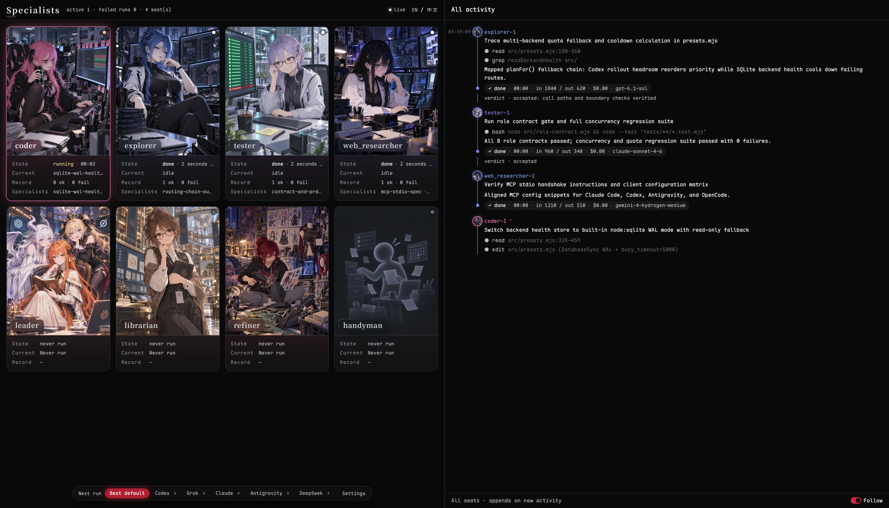
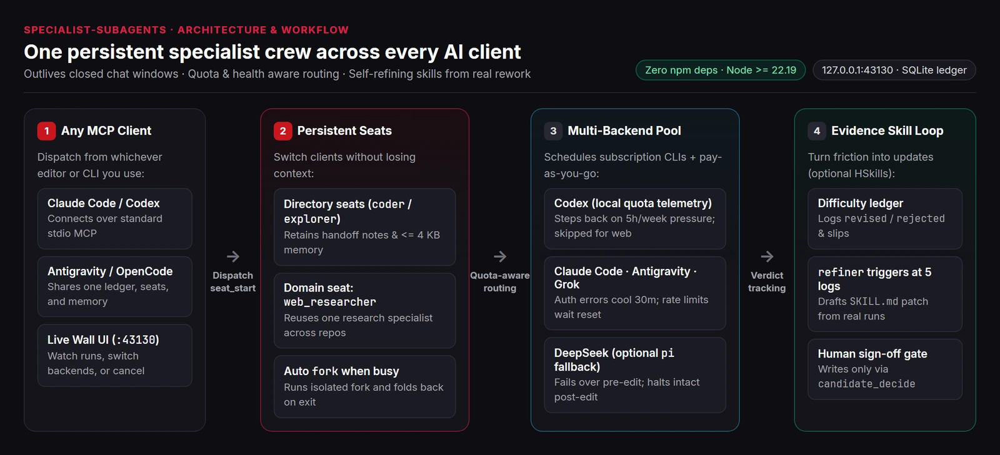

<div align="center">

# specialist-subagents

> Spec authority: [doc/PRD.md](./doc/PRD.md) · 需求以 `doc/PRD.md` 为准.

Persistent subagent seats shared across MCP clients, with local Codex quota avoidance, zero npm runtime dependencies, and an optional rework-to-skill feedback loop.

   

**`English` · [`简体中文`](./README.zh-CN.md)**

**Language:** `roles/*.md` prompt contracts are intentionally kept unchanged in Chinese as authentic production engineering samples. The Web UI (`?lang=en|zh`), CLI, MCP instructions, `dispatch/*.md`, and `doc/connect.md` default to English. Set `SPECIALIST_SUBAGENTS_LANG=zh` for Chinese mode, or use the header EN / 中文 toggle. Chinese guides live in `dispatch/zh-CN/` and `doc/connect.zh-CN.md`.



</div>

> [!TIP]
> If this multi-client orchestration approach helps your workflow, please consider giving this repo a **Star** at the top right so more builders can discover it.

## Why Use This / Differentiators

| Common approach | This service's boundary |
| --- | --- |
| Subagents scoped to one client's session | Shared SQLite ledger and named seats keyed by directory (`cwd`) or subject (`domain`), reusable across MCP clients. |
| Retry after a provider rejects work | Local Codex 5-hour/weekly quota readings move high-pressure backends later before dispatch; authentication/subscription failures cool for 30 minutes, exhausted quota until reset when known. |
| Install a runtime dependency tree | Node.js built-in `node:sqlite` and HTTP; zero npm production dependencies here. Backend CLIs are separate prerequisites. |
| Rewrite instructions from anecdotal feedback | Optional evidence-gated skill loop: difficulties and rework feed candidates, reviewed before activation. Contract-only use works without hskills; roles can set `skill_loop: false`. |

## Explicit Non-Goals & Security Caveats

- This is local orchestration, not a hosted model service or an OS sandbox. Interactive `start` / `demo` needs an installed, logged-in supported CLI, or `pi` plus `DEEPSEEK_API_KEY`; detection alone does not prove authentication.
- `web_researcher` has shell access; Antigravity paths use `agy --dangerously-skip-permissions`. On Windows these paths have no OS-level write interception, including when `tester` falls back to Antigravity.
- `commit_after_run` roles such as `librarian` stage **all uncommitted changes under their cwd**, including unrelated work.
- Default binding is `127.0.0.1:43130`. Multi-user hosts need `SPECIALIST_SUBAGENTS_TOKEN`; browser origin checks do not authenticate local processes. See [full security boundaries](#security-and-permission-boundaries).

## Read-Only Self-Check

Zero service/model side effects: `node src/role-contract.mjs` checks role contracts without starting the daemon. Portable scenario checks: `node --test "tests/scenarios/*.scenario.mjs"` use fake backends and temporary test state without model credentials; they do not establish full PRD acceptance.

## Architecture



The standard MCP stdio shell forwards to a local HTTP daemon. Persistent identity and records live outside the client process in SQLite; backend changes preserve a seat's records. Claude Code, Codex, Antigravity, OpenCode, and other MCP clients can share the same service.

Use it standalone, or pair it optionally with [HomuraTokido/hskills](https://github.com/HomuraTokido/hskills) for role skill evolution and cross-client rule compilation, and [HomuraTokido/hwiki](https://github.com/HomuraTokido/hwiki) for local knowledge storage, leak-screened search indexing, and hybrid retrieval. Neither companion repository is required for basic dispatch.

## Quickstart

Prerequisites: **Git** (clone the repository first), **Node.js >= 22.19.0**, and an installed, logged-in `codex`, `claude`, `agy` (Antigravity), or `grok` CLI; alternatively install `pi` and configure `DEEPSEEK_API_KEY`. No npm install is needed for this repository itself. CLI subscriptions and metered model usage can cost money.

```bash
git clone https://github.com/HomuraTokido/specialist-subagents.git
cd specialist-subagents
node src/role-contract.mjs
node bin/specialist-subagents.mjs start
```

`start` listens in the foreground. Open **http://127.0.0.1:43130** for the live role wall. In another terminal, connect a client and optionally exercise a real dispatch:

```bash
node bin/specialist-subagents.mjs status
claude mcp add -s user specialist-subagents -- node "<absolute-clone-path>/bin/specialist-subagents.mjs" mcp
node bin/specialist-subagents.mjs demo
```

`demo` requires at least one logged-in CLI backend, or a configured runtime/API key, and sends real work to a model. Complete client instructions are in [doc/connect.md](./doc/connect.md).

Interactive onboarding offers optional pi installation into `../runtimes/pi` or skipping it (default). With a subscription CLI present, skipping is saved in `.data/onboarding.json` and is not asked again; failed installation can also continue with that CLI. Without a subscription CLI, declining or failing installation prevents activation. CLI presence does not check login. Successful pi installation alone does not establish key availability: configure `DEEPSEEK_API_KEY` before dispatch.

Non-interactive `start` never reads stdin and permits watchdog startup without a detected backend, printing a warning instead of blocking. Non-interactive `demo` exits if neither a subscription CLI nor pi with a key is detected. Daemon startup is not evidence that a model can execute work.

### Local runtime configuration

Create gitignored `.runtime.json` in the repository root for a pi entry point, optional hskills checkout, and caller title:

```json
{
  "runtime": "../runtimes/pi/node_modules/@earendil-works/pi-coding-agent/dist/bundle/cli.js",
  "skills": "../hskills",
  "caller_title": "operator"
}
```

Optional manual pi installation uses the onboarding package version:

```bash
npm --prefix ../runtimes/pi install @earendil-works/pi-coding-agent@1.5.2
```

### web_researcher networking and optional hwiki

Search uses `node tools/web-search.mjs "query"`, configured with `agentWebSearch` in `.runtime.json`; keys are `TAVILY_API_KEY` / `BRAVE_API_KEY`. Tavily is preferred, with configured Brave fallback on failure. Original-page extraction and site structure use separately installed and authenticated `tvly`: `tvly extract`, `tvly map`, and `tvly crawl`.

When `hwiki` is installed, the role searches local notes first and writes newly sourced findings through `hwiki ai-note`. Otherwise it returns conclusions and source links directly; missing hwiki is not unfinished work.

## Security and Permission Boundaries

`deny_intent: ["write"]` constrains the startup tool allowlist and does not grant `edit` / `write`. A role with `bash` needs sandbox and contract enforcement together: an allowlist cannot constrain every side effect of arbitrary shell commands. The default networking role `web_researcher`, and `tester` on an Antigravity fallback, use shell access and `agy --dangerously-skip-permissions`. Antigravity's Windows sandbox cannot block writes outside cwd; these paths rely on the role contract for the no-write boundary, with **no OS-level write interception**.

After a `commit_after_run` role finishes, the service stages and locally commits **all uncommitted changes inside the seat's cwd**, not just files from that task. Only staged changes outside cwd cause refusal and rollback of this staging operation. Avoid directories containing unfinished manual work for such roles.

Hwiki's own CLI / MCP tools only make local commits, without network synchronization. However, `librarian` defaults to `sync_remote: true`. Explicitly setting `git config --local claude.allowPush true` in the target repository authorizes this service to pull and `git push` before/after librarian work. Hwiki leak screening protects the retrieval index (`document-index`), not file writes or local git commits.

The HTTP control plane validates Host against `127.0.0.1`, `localhost`, and `[::1]`. On non-GET/HEAD requests, Origin, when present, must exactly match this port's `http://127.0.0.1` or `http://localhost`; Sec-Fetch-Site must be `same-origin` / `none` when present. Nonempty JSON bodies require `Content-Type: application/json`; `POST /shutdown` accepts an empty body.

Origin / Sec-Fetch-Site checks stop browser cross-site requests. Without `SPECIALIST_SUBAGENTS_TOKEN`, any local non-browser process omitting these headers can call `/seat/start`, `/presets`, and `/shutdown`, including dispatching shell-capable roles using the current user's CLI login. Set the token on multi-user machines, shared servers, or machines with untrusted local scripts.

With `SPECIALIST_SUBAGENTS_TOKEN` set, every route except `GET /health` requires `Authorization: Bearer <token>`. Set the same value for daemon and CLI / MCP clients, which attach it automatically. Direct wall access and custom HTTP clients must also provide the header. An ordinary browser address bar cannot attach it; use an authenticated local proxy or client.

## CLI Reference

`--help` / `-h` prints full usage. Global `--port <number>` overrides `SPECIALIST_SUBAGENTS_PORT`. Start supports `--non-interactive` to suppress onboarding prompts and `--reset-onboarding` to clear saved onboarding choices.

```text
node bin/specialist-subagents.mjs <start|status|stop|seats [state]|pool|wait <seat|run> [--timeout s]|refine <role>|mcp|demo>
```

| Command | Behavior |
| --- | --- |
| `start` / `status` / `stop` | Start, inspect, or gracefully stop the local daemon. With a watchdog installed, `stop` allows restart with updated `src/` or `roles.json` within a minute; check active tasks before stopping. |
| `seats [state]` | List seats, optionally filtered by state. |
| `pool` | One-line active-task and open-seat counts per role; unreachable service yields an unknown-pool message without an error or blocking. |
| `wait <seat\|run> [--timeout s]` | Wait and print the same result as `task_result`. Default 6 hours, maximum 24; exit codes `0` done, `1` abnormal end, `2` usage error, `3` timeout. |
| `refine <role>` | Request a skill-refinement eligibility check. |
| `mcp` | Thin stdio forwarding shell; `--profile core` hides and disables four skill-refinement tools. Connects to an existing daemon without spawning one. |
| `demo` | Real model dispatch after onboarding checks. |

## Roles and Backends

### Eight roles in roles.json

<table>
  <tr>
    <td align="center"><br><b><code>leader</code></b><br><sub>Orchestration</sub></td>
    <td align="center"><br><b><code>explorer</code></b><br><sub>Read-only investigation</sub></td>
    <td align="center"><br><b><code>web_researcher</code></b><br><sub>Web evidence</sub></td>
    <td align="center"><br><b><code>coder</code></b><br><sub>Scoped implementation</sub></td>
  </tr>
  <tr>
    <td align="center"><br><b><code>tester</code></b><br><sub>Independent verification</sub></td>
    <td align="center"><br><b><code>librarian</code></b><br><sub>Knowledge curation</sub></td>
    <td align="center"><br><b><code>refiner</code></b><br><sub>Skill refinement</sub></td>
    <td align="center"><br><b><code>handyman</code></b><br><sub>One-off tasks</sub></td>
  </tr>
</table>

| Role | Capability (`grant`) | Addressing | Contract |
| --- | --- | --- | --- |
| `explorer` | `read` | Directory (`cwd`) | Read-only investigation of call paths and change boundaries. |
| `web_researcher` | `read`, `web` | Subject (`domain`) | Online verification and original-page extraction. |
| `coder` | `read`, `write`, `shell` | Directory (`cwd`) | Implement the leader's fixed approach. |
| `tester` | `read`, `shell` | Directory (`cwd`) | Independent tests; no source edits. |
| `librarian` | `read`, `write` | Directory (`cwd`) | Curate knowledge notes; automatic local `commit`, optional `sync_remote`. |
| `refiner` | `read`, `write` | Internal dispatch | `skill_refiner: true`; derive role skill candidates from difficulties. |
| `handyman` | `read`, `write`, `shell` | Directory (`cwd`) | One-off tasks; `skill_loop: false`. |
| `leader` | `read`, `write`, `shell`, `dispatch` | Directory (`cwd`) | Only `claude / codex / antigravity`; `timeout_minutes: 240`; `skill_loop: false`. |

Adding a role requires `roles/<role>.md`, a matching `roles/<role>.VERSION`, and a `roles.json` entry. Missing contracts or mismatched versions fail startup before binding the port.

The eight demo portraits in `assets/roles/<role>.png` were made by the author with `GPT Image 2.5`; the three model personifications in `leader.png` credit [ZipZipPipe](https://space.bilibili.com/4168597). Replace same-name images and refresh the browser; no daemon restart is needed. Portraits have a separate noncommercial scope; see [License](#license).

Role portraits visible in `doc/wall-preview*.webp` screenshots have the same **noncommercial interface demonstration only** scope, excluded from MIT commercial-use permission, with the same ZipZipPipe attribution. Replace the portraits and screenshots for commercial redistribution.

Code fonts prefer installed Maple Mono CN, or `MapleMono-CN-Regular.ttf` / `MapleMono-CN-Medium.ttf` in `assets/fonts/maple/`, falling back to system monospace. `assets/fonts/maple/*.ttf` is gitignored and absent from a clean clone.

### Execution backends and quota routing

`src/cli-runner.mjs` supports subscription CLIs `codex`, `grok`, `claude`, and Antigravity's `agy`; metered DeepSeek uses pi through `src/seat-runner.mjs`. `SPECIALIST_AGY_BIN` overrides agy's path; an explicitly empty or nonexistent override does not fall back.

[presets.json](./presets.json) defines order, `standard` / `max` models, effort, context sizes, compaction, and per-role `best` choices. Current examples: Codex `gpt-6.1-sol`, Antigravity standard `gemini-4-hydrogen-medium`, max `claude-opus-5-5-high`. The wall offers best defaults, a named backend, and lightning (`max`) tier; overrides live in `.data/backend-prefer.json` and `.data/presets.json`. Best defaults prioritize role fit and capability without cost preference; routing still considers health and quota. Network roles skip Codex on all platforms because its default sandbox lacks external networking. High-threshold Codex compaction (`compact.codex` / `model_context_window`) and pending end-to-end evidence: [doc/impl/compaction.md](./doc/impl/compaction.md).

Before dispatch, `src/presets.mjs` combines `.data/backend-health.sqlite` (read-only legacy `.data/backend-health.json` compatibility when absent) with the latest local Codex rollout 5-hour/weekly quota readings. Authentication/subscription restrictions cool for **30 minutes**; exhausted quota until a known reset (**15-minute fallback** if unknown); startup failures for **5 minutes**. High pressure moves Codex later; explicit user pinning preserves its high-pressure preference unless full or cooling.

Existing `.data/presets.json` overrides take precedence over repository `presets.json`; check local overrides when an updated default appears unchanged.

Failure **before work** can fall through to the next backend. Failure **after work** preserves the scene, lists changed files, and stops automatic retry. Exception: a `model_refusal*` safety-filter event allows one fresh session without history to take over, recorded as `takeover`.

For roles with `dispatch`, cli-runner mounts this service's MCP and injects `SPECIALIST_CALLER_SEAT` / `SPECIALIST_CALLER_DISPATCH`. The leader sees dispatch/result/verdict tools; ordinary roles cannot delegate further.

## MCP Tools: All 19

`src/mcp-stdio.mjs` owns no persistent state. At handshake it reads [dispatch/team-leader.md](./dispatch/team-leader.md) as MCP `instructions`; `dispatch_guide` serves the main or role-specific guide on demand. Public tool/CLI names and IDs such as `seat-coder-16` remain stable; a seat denotes a persistent specialist identity.

| Group | Tools | Purpose |
| --- | --- | --- |
| Dispatch and results (4) | `seat_start`, `task_wait`, `task_result`, `task_cancel` | `seat_start` returns seat/run IDs immediately; accepts `cwd`, `domain`, `topic`, named `seat`, and `fork: "context" \| "fresh"`. `task_wait` blocks for the report; `task_result` retrieves it. `task_cancel` ends the process tree, keeping seat and ledger. |
| Roles and seats (7) | `role_list`, `seat_list`, `seat_show`, `seat_rename`, `seat_close`, `seat_merge`, `seat_split` | Live role/backend/quota information; list, inspect, rename, archive, merge with handoff, or split by topic. |
| Verdict and memory (3) | `seat_verdict`, `memory_write`, `memory_read` | `accepted` / `revised` / `rejected`; latter two feed difficulties. Memory: 4000 characters/item, 4096-byte injection budget; `fact` before `lesson` / `note`. |
| Difficulties and evolution (4) | `difficulty_report`, `difficulty_decide`, `candidates`, `candidate_decide` | Inspect/adjudicate evidence; review skill candidate diffs and `enable` / `reject` / `defer` / `supersede`. Hidden and disabled under `--profile core`. |
| Dispatch guide (1) | `dispatch_guide` | Read the leader guide or `dispatch/<role>.md`. |

## Core Mechanisms

- **Continuity and forks** (`src/exec.mjs`, `src/closing.mjs`): every run records session resumption, record loading, or fresh creation. Recent records, `SPECIALIST_SEAT_HANDOFF_FILE`, and directory-change summaries accompany tasks. Contract/skill updates appear through `resume-notice.md`. A busy seat or explicit `fork` creates a parallel fork; its records rejoin the parent and it closes. Long tasks travel through `task.md` to avoid command-line limits.
- **Asynchronous process-tree cleanup and orphan adoption** (`src/proc.mjs`): Windows uses asynchronous `taskkill /PID <pid> /T /F`; POSIX terminates process groups without blocking the event loop. Daemon restart adopts still-live recorded processes and completes normal closing.
- **Difficulty exemptions and review gates** (`src/skill-loop.mjs`, `src/expected-traces.mjs`): five difficulties trigger refiner eligibility. `expected_traces` exempts normal outcomes such as tester finding failing code or coder finding no old references. Boundary violations, unexpected errors, and repeated retries feed evidence. Candidate `SKILL.md` reaches the configured skills repository only after human/leader `enable`. Unconfigured hskills allows contract-only use; `skill_loop: false` disables per-role refinement.

## HTTP Routes, Configuration, and Watchdog

### Local HTTP surface

`src/daemon.mjs` binds `127.0.0.1`; authentication/origin rules are detailed [above](#security-and-permission-boundaries). The wall updates incrementally via `/events/wait` long polling.

| Surface | Routes |
| --- | --- |
| Wall and health | `GET /` (HTML monitor wall), `GET /wall` (JSON API), `GET /pool`, `GET /health`, `GET /backend/health`, `GET /assets/<file>`, `POST /shutdown` |
| Seats and dispatch | `GET /roles`, `GET /seats`, `GET /seats/<id>`, `GET /run`, `POST /seat/open`, `POST /seat/bind`, `POST /seat/close`, `POST /seat/record`, `POST /seat/verdict`, `POST /seat/start`, `POST /seat/rename`, `POST /task/cancel`, `POST /seat/merge`, `POST /seat/split` |
| Memory, costs, evolution | `POST /memory/write`, `GET /memory/read`, `GET /costs`, `GET /difficulties`, `POST /difficulties/decide`, `GET /candidates`, `POST /candidates/decide`, `POST /skill-loop/refine`, `GET /reminders` |
| Backends and presets | `GET /backend`, `POST /backend`, `GET /presets`, `POST /presets`, `GET /settings`, `GET /models`, `GET /events`, `GET /events/wait` |

### Environment variables and local files

| Setting | Meaning |
| --- | --- |
| `SPECIALIST_SUBAGENTS_PORT` | Daemon port, default `43130`. |
| `SPECIALIST_SUBAGENTS_LANG` | English by default; values starting with `zh` enable Chinese. Browser `?lang=en|zh` overrides the daemon default. |
| `SPECIALIST_SUBAGENTS_TOKEN` | Optional Bearer authentication; same value on daemon/clients. |
| `SPECIALIST_AGY_BIN` | Exact agy override; without override, home default then PATH. Explicit overrides never fall back. |
| `SPECIALIST_SUBAGENTS_DB` | Ledger path, default `.data/ledger.sqlite3`. |
| `SPECIALIST_SUBAGENTS_MAX_CONCURRENCY` | Default `10`; overflow HTTP 429, no queue. |
| `SPECIALIST_SUBAGENTS_RUNTIME` | pi CLI entry, alternative to `.runtime.json` `runtime`. |
| `SPECIALIST_SUBAGENTS_SKILLS` / `SPECIALIST_SUBAGENTS_HSKILLS` | External skills repository: environment first, then `.runtime.json` `skills` / `hskills`. Unset resolves to `null`, without probing personal directories; contracts still work. |
| `.schedules.json` | Gitignored machine-local schedules, checked every minute. |

### Boot watchdog

The OS owns daemon lifetime, preventing client Job Object / cgroup shutdown from ending active seats. Install separately:

- Windows: `pwsh -File tools/install-watchdog.ps1` registers login entry `specialist-subagents-watchdog.vbs`, checks `/health` every minute, and starts an unreachable daemon.
- macOS: `bash tools/install-watchdog.sh` registers a LaunchAgent.
- Linux: `bash tools/install-watchdog-linux.sh` registers systemd user service `specialist-subagents-watchdog.service`; `--remove` uninstalls it.

## Tests and PRD Acceptance

Only `node tools/prd-check.mjs` determines requirement status. `npm test` runs the test suite; it does not replace the PRD checker. [doc/PRD.md](./doc/PRD.md) supersedes `doc/REQUIREMENTS.md`; end-to-end scenarios establish behavior, component tests locate failures.

Eight `LOCAL_ONLY` checks require local evidence: **H-1, H-2** (host config), **H-4, O-2** (host injection/notification), **C-6** (real ledger statistics), **B-2, K-1, K-4** (real knowledge-repository commits/synchronization). A clean clone lacks that evidence and exits **1**, reporting that local-machine evidence is required for these checks. This adds no requirement end state and is separate from portable-test success.

```bash
node src/role-contract.mjs
node --test "tests/scenarios/*.scenario.mjs"
node tools/prd-check.mjs
node --test --test-concurrency=4 "tests/**/*.test.mjs"
```

## License

Code and documentation use [MIT](./LICENSE). The author's `GPT Image 2.5` demo portraits (`assets/roles/*.png`) are for **noncommercial interface demonstration only**, excluded from MIT commercial-use permission. Replace or remove them for commercial redistribution or repackaging. The character concepts in `leader.png` credit [ZipZipPipe](https://space.bilibili.com/4168597).
