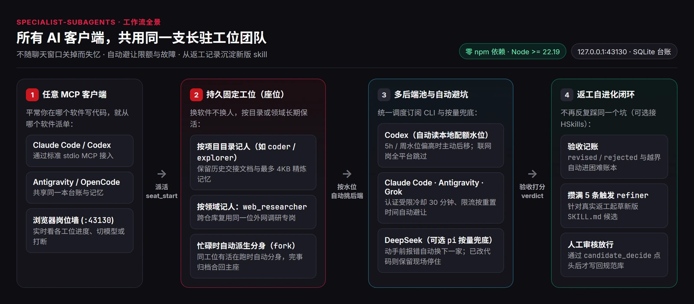

<div align="center">

# specialist-subagents

> 需求以 `doc/PRD.md` 为准：见 [doc/PRD.md](./doc/PRD.md)。

跨 MCP 客户端共享长驻 subagent 座位，以本地 Codex 配额水位提前避让、零 npm 依赖 MCP 和可选返工到 skill 闭环，减少换客户端后的重复劳动。

   

**`简体中文` · [`English`](./README.md)**

**语言说明：** `roles/*.md` 提示词合同刻意保持中文，作为真实生产工程样本。Web UI（`?lang=en|zh`）、CLI、MCP instructions、`dispatch/*.md` 与 `doc/connect.md` 默认英文；`SPECIALIST_SUBAGENTS_LANG=zh` 提供中文模式，网页顶栏 EN / 中文 可切换。中文指南位于 `dispatch/zh-CN/` 与 `doc/connect.zh-CN.md`。


</div>

> [!TIP]
> 如果这套跨客户端编排方案对你的工作流有帮助，欢迎在右上角顺手点一个 **Star**，让更多人看到它。

## 为什么用它 / 差异

| 常见做法 | 本服务的明确边界 |
| --- | --- |
| subagent 随单个客户端会话结束 | 共享 SQLite 台账，按目录（`cwd`）或领域（`domain`）保留具名座位，跨 MCP 客户端复用。 |
| 后端拒绝任务后再重试 | 派单前读取本地 Codex 5 小时 / 周配额水位，高压后端提前后移；认证或订阅受限冷却 30 分钟，配额耗尽按已知重置时间冷却。 |
| 先安装一棵依赖树 | 只用 Node.js 内置 `node:sqlite` 与 HTTP，本仓零 npm 生产依赖；后端 CLI 另行准备。 |
| 凭零散反馈改规则 | 可选、经证据与审核把关的 skill 闭环：困难与返工生成候选，核准后启用。未配 hskills 可用纯合同模式；岗位可设 `skill_loop: false`。 |

## 明确非目标与安全边界

- 本服务负责本地编排，不提供托管模型或 OS 沙箱。交互式 `start` / `demo` 需要至少一家已安装且已登录的支持 CLI，或 `pi` 加 `DEEPSEEK_API_KEY`；检测到命令不代表认证有效。
- `web_researcher` 可用 shell；Antigravity 路径使用 `agy --dangerously-skip-permissions`。Windows 上这些路径没有 OS 级写拦截，包括 `tester` 顺延到 Antigravity 的情形。
- `commit_after_run` 岗位（如 `librarian`）会暂存 **cwd 内全部尚未 commit 的改动**，包括本单以外的工作。
- 默认绑定 `127.0.0.1:43130`。多用户主机需设 `SPECIALIST_SUBAGENTS_TOKEN`；浏览器来源校验无法认证其他本地进程。见[完整安全边界](#安全与权限边界)。

## 只读自检

零服务 / 模型副作用：`node src/role-contract.mjs` 只检查岗位合同，不启动 daemon。可移植场景检查：`node --test "tests/scenarios/*.scenario.mjs"` 使用假后端与临时测试状态，无需模型凭据；这些检查不代表整份 PRD 已验收。

## 架构



标准 MCP stdio 壳转发到本地 HTTP daemon。持久身份与记录保存在客户端进程外的 SQLite 台账，切换后端仍可保留座位记录。Claude Code、Codex、Antigravity、OpenCode 等 MCP 客户端可以共享同一服务。

本仓可独立使用，也可按需搭配 [HomuraTokido/hskills](https://github.com/HomuraTokido/hskills)，获得岗位 skill 演化与跨客户端规则编译；搭配 [HomuraTokido/hwiki](https://github.com/HomuraTokido/hwiki)，获得本地知识存储、带防泄密筛查的检索索引与混合检索。基础派单无需这两个可选仓库。

## 快速开始

前提：**Node.js >= 22.19.0**，以及已安装并登录的 `codex`、`claude`、`agy`（Antigravity）或 `grok` CLI；也可安装 `pi` 并配置 `DEEPSEEK_API_KEY`。本仓自身无需 npm install。CLI 订阅与按量模型可能产生费用。

```bash
git clone https://github.com/HomuraTokido/specialist-subagents.git
cd specialist-subagents
node src/role-contract.mjs
node bin/specialist-subagents.mjs start
```

`start` 在前台监听，打开 **http://127.0.0.1:43130** 查看实时岗位墙。在另一个终端接客户端，并按需体验一次真实派单：

```bash
node bin/specialist-subagents.mjs status
claude mcp add -s user specialist-subagents -- node "<克隆目录绝对路径>/bin/specialist-subagents.mjs" mcp
node bin/specialist-subagents.mjs demo
```

`demo` 需要至少一家已登录的 CLI 后端，或已配置的运行时/API key，会让模型执行真实任务。先安装 Git 并克隆仓库；各客户端完整接法见 [doc/connect.zh-CN.md](./doc/connect.zh-CN.md)。

交互引导会询问是否安装可选 pi 到 `../runtimes/pi`，或跳过（默认）。有订阅 CLI 时，跳过选择写入 `.data/onboarding.json`，以后不重复询问；pi 安装失败也可继续使用该 CLI。无订阅 CLI 时，拒绝安装或安装失败会阻止激活。命令存在不代表已登录；pi 安装成功也不代表密钥齐备，派单前仍需配置 `DEEPSEEK_API_KEY`。

非交互 `start` 从不读取 stdin，缺后端时打印警告并允许看门狗启动，不会阻塞等待输入。非交互 `demo` 在未检测到订阅 CLI、也没有 pi 与密钥组合时退出。daemon 启动成功不代表模型一定能接单。

### 本地 runtime 配置

在仓库根目录新建已 gitignore 的 `.runtime.json`，指定 pi 入口、可选 hskills 路径与称呼：

```json
{
  "runtime": "../runtimes/pi/node_modules/@earendil-works/pi-coding-agent/dist/bundle/cli.js",
  "skills": "../hskills",
  "caller_title": "operator"
}
```

手动安装 pi 可使用与引导相同的固定版本：

```bash
npm --prefix ../runtimes/pi install @earendil-works/pi-coding-agent@1.5.2
```

### web_researcher 联网与可选 hwiki

搜索使用 `node tools/web-search.mjs "查询"`，在 `.runtime.json` 配置 `agentWebSearch`；密钥为 `TAVILY_API_KEY` / `BRAVE_API_KEY`。优先 Tavily，失败后按配置回退 Brave。读原页与站点结构使用另行安装且已认证的 `tvly`：`tvly extract`、`tvly map`、`tvly crawl`。

装有 `hwiki` 时，岗位先检索本地笔记，新查到的材料通过 `hwiki ai-note` 写回。未安装时直接交回结论和来源链接，缺少 hwiki 不列入未完成。

## 安全与权限边界

`deny_intent: ["write"]` 在启动门禁中约束工具白名单，不授予 `edit` / `write`。具备 `bash` 的岗位需要沙箱与合同共同约束，白名单无法限制任意 shell 命令的全部副作用。默认联网岗位 `web_researcher`、以及顺延到 Antigravity 的 `tester`，可用 shell 并以 `agy --dangerously-skip-permissions` 启动。Antigravity 在 Windows 上无法阻断 cwd 外写入，这些路径的禁写边界依赖岗位合同，**没有 OS 级写拦截**。

`commit_after_run` 岗位结束后，服务会暂存并在本地 commit **座位 cwd 内全部尚未 commit 的改动**，范围包括本单以外的文件。只有暂存区出现 cwd 外改动时，才拒绝 commit 并撤回本次暂存。此类任务应避开混有未完成手工改动的目录。

Hwiki 自身的 CLI / MCP 工具只做本地 commit，不联网同步。但 `librarian` 默认 `sync_remote: true`。目标仓库显式设置 `git config --local claude.allowPush true`，即授权本编排服务在 librarian 整理前后执行 pull 与 `git push`。Hwiki 防泄密筛查保护的是检索索引（`document-index`），不拦截文件写入或本地 git commit。

HTTP 控制面校验 Host，只接受 `127.0.0.1`、`localhost`、`[::1]`。非 GET / HEAD 请求携带 Origin 时，必须严格匹配本端口的 `http://127.0.0.1` 或 `http://localhost`；携带 Sec-Fetch-Site 时仅接受 `same-origin` / `none`。非空 JSON 请求体需使用 `Content-Type: application/json`；`POST /shutdown` 可用空 body。

Origin / Sec-Fetch-Site 只拦截浏览器跨站请求。未设 `SPECIALIST_SUBAGENTS_TOKEN` 时，同机非浏览器进程不带这两个头即可访问 `/seat/start`、`/presets`、`/shutdown`，并利用当前用户 CLI 登录态派发带 shell 的岗位。多用户主机、共享服务器或存在不可信本地脚本的机器应设 token。

设置 `SPECIALIST_SUBAGENTS_TOKEN` 后，除 `GET /health` 外均需 `Authorization: Bearer <token>`。daemon 与 CLI / MCP 客户端配置相同值，CLI / MCP 自动附带该头；直接访问岗位墙及自写 HTTP 客户端也需提供该头。普通浏览器地址栏无法附带它，需使用已认证的本地代理或客户端。

## CLI 清单

`--help` / `-h` 显示完整帮助；全局 `--port <number>` 覆盖环境变量端口；`start --non-interactive` 禁止询问，`start --reset-onboarding` 清空已保存的引导选择。

```text
node bin/specialist-subagents.mjs <start|status|stop|seats [state]|pool|wait <seat|run> [--timeout s]|refine <role>|mcp|demo>
```

| 命令 | 行为 |
| --- | --- |
| `start` / `status` / `stop` | 启动、查看或优雅停止本机 daemon。已装看门狗时，`stop` 后会在一分钟内按新 `src/` 或 `roles.json` 拉起；停止前需检查活跃任务。 |
| `seats [state]` | 查看座位名录，可按状态筛选。 |
| `pool` | 一行显示各岗位活跃任务数和未关闭座位数；服务不可达时显示池状态未知，不报错、不阻塞。 |
| `wait <seat\|run> [--timeout s]` | 等待结束，打印与 `task_result` 相同的结果。默认 6 小时，上限 24 小时；退出码 `0` 完成、`1` 异常结束、`2` 用法错误、`3` 超时。 |
| `refine <role>` | 请求检查指定岗位是否符合 skill 提炼条件。 |
| `mcp` | 薄 stdio 转发壳；`--profile core` 隐藏并禁用 4 个 skill 提炼工具。只连接现有 daemon，不自行拉起。 |
| `demo` | 引导检查后进行真实模型派单。 |

## 岗位与后端

### roles.json 中的 8 个岗位

<table>
  <tr>
    <td align="center"><br><b><code>leader</code></b><br><sub>组长编排</sub></td>
    <td align="center"><br><b><code>explorer</code></b><br><sub>只读摸底</sub></td>
    <td align="center"><br><b><code>web_researcher</code></b><br><sub>联网查证</sub></td>
    <td align="center"><br><b><code>coder</code></b><br><sub>定点实现</sub></td>
  </tr>
  <tr>
    <td align="center"><br><b><code>tester</code></b><br><sub>独立验证</sub></td>
    <td align="center"><br><b><code>librarian</code></b><br><sub>知识归档</sub></td>
    <td align="center"><br><b><code>refiner</code></b><br><sub>skill 提炼</sub></td>
    <td align="center"><br><b><code>handyman</code></b><br><sub>零碎杂活</sub></td>
  </tr>
</table>

| 岗位 | 能力（`grant`） | 寻址 | 合同 |
| --- | --- | --- | --- |
| `explorer` | `read` | 目录（`cwd`） | 只读调查调用链与改动边界。 |
| `web_researcher` | `read`、`web` | 领域（`domain`） | 联网查证与原页提取。 |
| `coder` | `read`、`write`、`shell` | 目录（`cwd`） | 按组长定死的改法实现。 |
| `tester` | `read`、`shell` | 目录（`cwd`） | 独立测试，不改源码。 |
| `librarian` | `read`、`write` | 目录（`cwd`） | 整理知识笔记，自动本地 `commit`，可选 `sync_remote`。 |
| `refiner` | `read`、`write` | 服务内部派发 | `skill_refiner: true`，按困难证据提炼岗位 skill 候选。 |
| `handyman` | `read`、`write`、`shell` | 目录（`cwd`） | 一次性杂活，`skill_loop: false`。 |
| `leader` | `read`、`write`、`shell`、`dispatch` | 目录（`cwd`） | 只走 `claude / codex / antigravity`；`timeout_minutes: 240`；`skill_loop: false`。 |

新增岗位需补齐 `roles/<role>.md`、匹配的 `roles/<role>.VERSION` 和 `roles.json` 条目。缺合同或版本不一致时，daemon 在绑定端口前拒绝启动。

8 张默认演示立绘位于 `assets/roles/<role>.png`，由作者用 `GPT Image 2.5` 制作；`leader.png` 三位模型拟人形象设定致谢 [ZipZipPipe](https://space.bilibili.com/4168597)。用自己的图片覆盖同名文件、刷新浏览器即可生效，无需重启。立绘单独限定非商业范围，见[许可](#许可)。

`doc/wall-preview*.webp` 截图中的岗位肖像同样仅限非商业界面演示，排除在 MIT 商用授权外，并保留上述 ZipZipPipe 署名。商业再发行请替换相关肖像与截图。

代码字体优先使用已安装的 Maple Mono CN，或 `assets/fonts/maple/` 下的 `MapleMono-CN-Regular.ttf` / `MapleMono-CN-Medium.ttf`，缺省回退系统等宽字体。`assets/fonts/maple/*.ttf` 已 gitignore，干净克隆不带这些字体。

### 执行后端与水位调度

`src/cli-runner.mjs` 支持订阅 CLI `codex`、`grok`、`claude`、Antigravity 的 `agy`；按量 DeepSeek 经 `src/seat-runner.mjs` 调用 pi。`SPECIALIST_AGY_BIN` 可覆盖 agy 路径，显式空值或不存在的路径均不回退。

[presets.json](./presets.json) 定义后端顺序、`standard` / `max` 型号、思考档位、上下文容量、压缩参数和各岗位 `best`。当前例子：Codex `gpt-6.1-sol`、Antigravity 标准档 `gemini-4-hydrogen-medium`、高档 `claude-opus-5-5-high`。岗位墙可选最佳默认、指定后端及闪电（`max`）档，本机覆盖存于 `.data/backend-prefer.json` 和 `.data/presets.json`。最佳默认按岗位适配与能力选择，不按成本偏好选择；实际调度仍考虑健康与配额。联网岗位在全平台跳过默认沙箱无外网的 Codex。Codex 高阈值压缩（`compact.codex` / `model_context_window`）及待端到端实测说明见 [doc/impl/compaction.md](./doc/impl/compaction.md)。

派单前，`src/presets.mjs` 结合 `.data/backend-health.sqlite`（缺库时只读兼容旧 `.data/backend-health.json`）与本地 Codex rollout 最新 5 小时 / 周配额水位。认证或订阅受限冷却 **30 分钟**；配额耗尽按已知重置时间冷却，未知时兜底 **15 分钟**；启动故障冷却 **5 分钟**。高压时 Codex 后移；用户显式点名可保留高压首选，但满额或冷却时仍避让。

已有 `.data/presets.json` 本机覆盖优先于仓库 `presets.json`；更新默认值后请先确认旧覆盖是否仍在生效。

后端在**动手前**失败可顺延下一家；**动手后**失败则保留现场、列出已改文件并停止自动重试。唯一例外：`model_refusal*` 安全过滤事件允许一个不带历史的新会话接手一次，记为 `takeover`。

带 `dispatch` 的岗位由 cli-runner 挂载本服务 MCP，并注入 `SPECIALIST_CALLER_SEAT` / `SPECIALIST_CALLER_DISPATCH`。leader 只见派单、结果、验收工具，普通岗位不能继续派人。

## MCP 工具：全部 19 个

`src/mcp-stdio.mjs` 不自持状态；握手时读取 [dispatch/team-leader.md](./dispatch/team-leader.md) 作为 MCP `instructions`。`dispatch_guide` 按需提供总纲或单岗指南。公开工具名、CLI 名与 `seat-coder-16` 等标识保持稳定；座位表示持久 specialist 身份。

| 分组 | 工具 | 用途 |
| --- | --- | --- |
| 派单与结果（4） | `seat_start`、`task_wait`、`task_result`、`task_cancel` | `seat_start` 立即返回座位号与 run 号，接受 `cwd`、`domain`、`topic`、点名 `seat` 与 `fork: "context" \| "fresh"`。`task_wait` 阻塞等报告；`task_result` 取结果；`task_cancel` 终止进程树，保留座位与台账。 |
| 岗位与座位（7） | `role_list`、`seat_list`、`seat_show`、`seat_rename`、`seat_close`、`seat_merge`、`seat_split` | 实时岗位、后端与水位信息；名录、详情、改名、归档、合并并交接、按主题拆分。 |
| 验收与记忆（3） | `seat_verdict`、`memory_write`、`memory_read` | `accepted` / `revised` / `rejected`，后两者进入困难账本。记忆单条 4000 字符，注入预算 4096 字节；`fact` 优先于 `lesson` / `note`。 |
| 困难与演化（4） | `difficulty_report`、`difficulty_decide`、`candidates`、`candidate_decide` | 查看、裁决困难；审阅 skill 候选 diff，执行 `enable` / `reject` / `defer` / `supersede`。`--profile core` 隐藏并禁用此组。 |
| 派活指南（1） | `dispatch_guide` | 读取组长指南或 `dispatch/<role>.md`。 |

## 核心机制

- **连续性与分身**（`src/exec.mjs`、`src/closing.mjs`）：每次 run 记录续接会话、装载记录或全新对象等方式。任务附带近期记录、`SPECIALIST_SEAT_HANDOFF_FILE` 与目录变化摘要；合同 / skill 变更通过 `resume-notice.md` 增量告知。座位正忙或显式 `fork` 时派生并行分身，结束后记录归回主座位、关闭分身。超长任务经 `task.md` 透传，避开命令行长度限制。
- **异步进程树清理与孤儿接管**（`src/proc.mjs`）：Windows 异步执行 `taskkill /PID <pid> /T /F`，POSIX 按进程组终止，不阻塞事件循环。daemon 重启后接管台账中仍存活的进程并完成统一收尾。
- **困难豁免与审核门**（`src/skill-loop.mjs`、`src/expected-traces.mjs`）：累计 5 条困难触发 refiner 条件检查。`expected_traces` 豁免 tester 测出代码失败、coder 查旧引用零命中等正常岗位现象；越界、异常报错、连续重复重试进入证据账本。候选 `SKILL.md` 经人工 / 组长 `enable` 后才写入配置的 skills 仓库。未配 hskills 可用纯合同模式；`skill_loop: false` 关闭单岗提炼。

## HTTP 路由、配置与看门狗

### 本地 HTTP 接口

`src/daemon.mjs` 绑定 `127.0.0.1`，认证与来源规则见[安全与权限边界](#安全与权限边界)。岗位墙通过 `/events/wait` 长轮询增量刷新。

| 接口组 | 路由 |
| --- | --- |
| 岗位墙与健康 | `GET /`（HTML 岗位墙）、`GET /wall`（JSON API）、`GET /pool`、`GET /health`、`GET /backend/health`、`GET /assets/<file>`、`POST /shutdown` |
| 座位与派单 | `GET /roles`、`GET /seats`、`GET /seats/<id>`、`GET /run`、`POST /seat/open`、`POST /seat/bind`、`POST /seat/close`、`POST /seat/record`、`POST /seat/verdict`、`POST /seat/start`、`POST /seat/rename`、`POST /task/cancel`、`POST /seat/merge`、`POST /seat/split` |
| 记忆、成本、演化 | `POST /memory/write`、`GET /memory/read`、`GET /costs`、`GET /difficulties`、`POST /difficulties/decide`、`GET /candidates`、`POST /candidates/decide`、`POST /skill-loop/refine`、`GET /reminders` |
| 后端与预设 | `GET /backend`、`POST /backend`、`GET /presets`、`POST /presets`、`GET /settings`、`GET /models`、`GET /events`、`GET /events/wait` |

### 环境变量与本地文件

| 配置 | 含义 |
| --- | --- |
| `SPECIALIST_SUBAGENTS_PORT` | daemon 端口，默认 `43130`。 |
| `SPECIALIST_SUBAGENTS_LANG` | 默认英文；以 `zh` 开头的值启用中文。网页 `?lang=en|zh` 优先于 daemon 默认语言。 |
| `SPECIALIST_SUBAGENTS_TOKEN` | 可选 Bearer 认证；daemon 与客户端值相同。 |
| `SPECIALIST_AGY_BIN` | agy 精确路径；未设时先查家目录默认路径再查 PATH，显式覆盖后不回退。 |
| `SPECIALIST_SUBAGENTS_DB` | 台账路径，默认 `.data/ledger.sqlite3`。 |
| `SPECIALIST_SUBAGENTS_MAX_CONCURRENCY` | 默认 `10`，超限 HTTP 429，不排队。 |
| `SPECIALIST_SUBAGENTS_RUNTIME` | pi CLI 入口，也可设 `.runtime.json` 的 `runtime`。 |
| `SPECIALIST_SUBAGENTS_SKILLS` / `SPECIALIST_SUBAGENTS_HSKILLS` | 外部 skills 仓库，环境变量优先，再读 `.runtime.json` 的 `skills` / `hskills`。均未设则为 `null`，不探测个人目录，合同模式照常可用。 |
| `.schedules.json` | 已 gitignore 的本机定时配置，每分钟检查。 |

### 开机看门狗

daemon 寿命由 OS 管理，避免客户端 Job Object / cgroup 结束时连带终止活跃座位。看门狗另行安装：

- Windows：`pwsh -File tools/install-watchdog.ps1` 注册登录项 `specialist-subagents-watchdog.vbs`，每分钟检查 `/health`，不可达时拉起 daemon。
- macOS：`bash tools/install-watchdog.sh` 注册 LaunchAgent。
- Linux：`bash tools/install-watchdog-linux.sh` 注册 systemd 用户服务 `specialist-subagents-watchdog.service`；`--remove` 卸载。

## 测试与 PRD 验收

只有 `node tools/prd-check.mjs` 决定需求状态。`npm test` 运行测试套件，不能替代 PRD 检查器。[doc/PRD.md](./doc/PRD.md) 已取代 `doc/REQUIREMENTS.md`；端到端场景验行为，零件测试用于定位失败。

8 项 `LOCAL_ONLY` 依赖本机证据：**H-1、H-2**（宿主配置）、**H-4、O-2**（宿主注入与通知）、**C-6**（真实台账数字）、**B-2、K-1、K-4**（真实知识库 commit 与同步）。干净克隆缺少这些证据时退出码为 **1**，这些检查标记为 `需要本机`。这不新增需求终态，须与可移植测试结果分别说明。

```bash
node src/role-contract.mjs
node --test "tests/scenarios/*.scenario.mjs"
node tools/prd-check.mjs
node --test --test-concurrency=4 "tests/**/*.test.mjs"
```

## 许可

代码与文档采用 [MIT](./LICENSE)。作者用 `GPT Image 2.5` 制作的默认立绘（`assets/roles/*.png`）**仅供非商业界面演示**，不纳入 MIT 商用授权范围；商业分发或二次打包需替换或移除。角色概念中的 `leader.png` 形象设定致谢 [ZipZipPipe](https://space.bilibili.com/4168597)。
