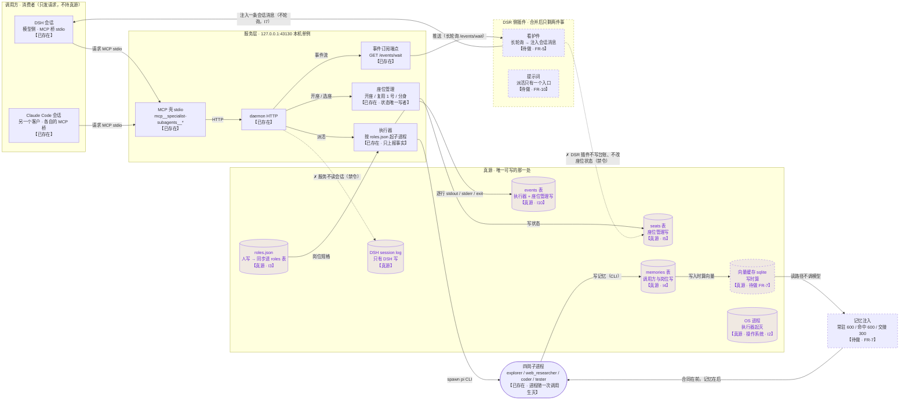
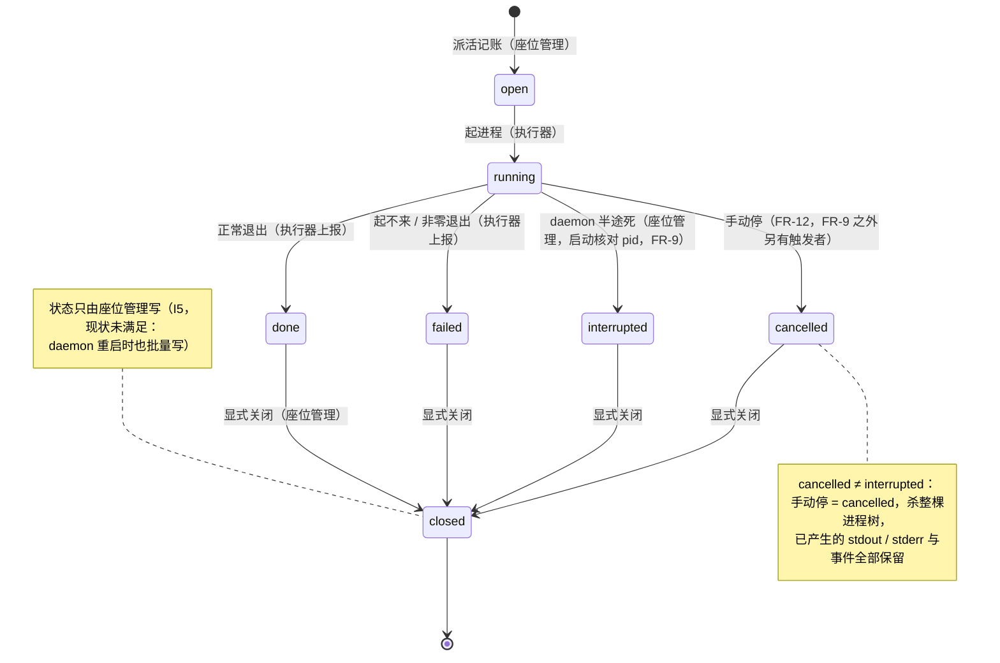
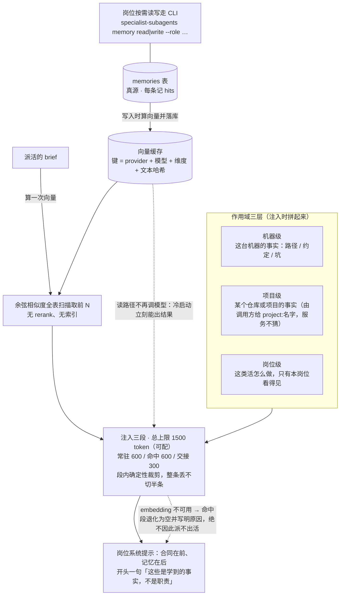

> **注意（2026-09-30）：本文件和 `architecture.html` 是 2026-09-19 的快照，不再随代码更新。** 现行行为以 `README.md` 和 `PRD.md` 为准（例如岗位现在是 8 个、执行层有 seat-runner 与 cli-runner 两种、取消已实现、启动时会接管孤儿座位、第 7 节的旧向量缓存与三段 token 配额构想已由 `src/store.mjs` 的 4096 字节纯文本岗位记忆取代）。第 11 节记录的 sha256 是原始渲染产物的（那时还没有顶部的这条提示）；`architecture.html` 顶部现在多了一行同样内容的提示，所以它的实际哈希已经不同。

# specialist-subagents 目标架构 · 结构图（v2）

> 一句话：**只有一个 subagent 系统，就是这一个。**
> 本机单例跑在 `127.0.0.1:43130`；DSH 会话与 Claude Code 会话是同一个服务的两个客户。

配套文件：

- [`architecture.html`](architecture.html) —— 同一张图的可交互版本（archify `architecture` 类型渲染，自包含单文件、内联 SVG、深浅色主题、pan/zoom/搜索/聚焦/5 个引导章节/导出）。
- 本文件 —— mermaid 源码、文字说明，以及生成 HTML 用的 archify 规格附录。
- `archive/architecture-v1.html` 与 `archive/architecture-v1.md` 为早期未随仓发行的本地归档稿（只画了构件与箭头的那一版），不是当前仓库中的文件。
- 2026-09-19 绘制时的原始事实来源是历史稿 `REQUIREMENTS.md` 第 4、5 节；现行权威需求已迁至 `doc/PRD.md`。本文件与那张图**不新增事实**，只把当时第 4 节已经写清楚的结构画出来。

## 0. 这一版补的是什么

v1 的画法只有两样东西：方块（构件）和箭头（连线）。但架构真正的内容不在那里，而在下面五样，v1 一样都没有：

| v1 缺的 | v2 怎么画 |
|---|---|
| **归属**：谁拥有什么、谁写什么 | 每个方块带徽标写明「真源 / 消费者 / 谁写」；真源统一用紫色方块，并单独圈成一个区域 |
| **方向规则**：不许反向 | 实线 = 请求（调用方 → 服务），虚线 = 事件（服务 → 调用方）；两条禁令画成带 ✗ 的红色方块 + 警示虚线 |
| **座位状态机**：状态与触发者 | 一个独立区域，8 个状态 + 每个状态徽标写明谁触发 |
| **一次派活的七步与每步失败面** | 底部一条七步主链，每步的失败写在方块里（桥断 / 规格坏 / 起不来 / 输出超限 / daemon 半途死 / 通知丢） |
| **不变量** | 挑三条最容易被破坏的（I1 / I2 / I5）单独画成红色方块，其余用徽标标注在相关方块上 |
| **状态标注** | 每个方块带 `已存在` / `待做` / `已关闭` / `已退役` |

另外补上记忆那一块的结构：三层作用域（机器 / 项目 / 岗位）、三段注入（常驻 600 / 命中 600 / 交接 300）、向量缓存（写时算、读路径不需要模型）。

---

## 1. mermaid 源码

### 1.1 归属与方向（4.1 / 4.2）



### 1.2 座位状态机（4.4 I5 / FR-8 / FR-9 / FR-12）



### 1.3 一次派活的七步与每步失败面（4.3）


### 1.4 记忆：作用域三层、注入三段、向量缓存（4.6 / 4.8）



---

## 2. 归属表（图上的紫色方块就是这个表的可视化）

| 东西 | 唯一真源 | 谁能写 | 生命周期 | 图上的方块 |
|---|---|---|---|---|
| 岗位定义（合同、能力白名单、起什么进程） | `roles.json` | 人；服务启动时同步进 `roles` 表 | 长期 | `roles.json`【真源 · I3】 |
| 座位（身份、编号、归属、状态） | 服务的 `seats` 表 | **只应由座位管理写**（现状不满足，见 4.5） | 永久，除非显式关闭 | `seats 表`【真源 · I5】 |
| 事件流（逐行） | 服务的 `events` 表 | 执行器（stdout / stderr / exit）+ 座位管理（状态变化） | 永久 | `events 表`【真源 · I10】 |
| 岗位记忆 | 服务的 `memories` 表 | 调用方与岗位自己 | 永久 | `memories 表`【真源 · I4】 |
| 向量（4.8） | sqlite 里的缓存表 | 服务（写入时算） | 与记忆同生 | `向量缓存（sqlite）`【真源】 |
| 会话 | DSH 自己的 session log | DSH | 随会话 | `DSH session log`【真源】 |
| 进程 | 操作系统 | 执行器 | 一次调用 | `OS 进程`【真源 · 操作系统】 |

读法：**紫色 = 真源（唯一可写的那一处）；青色 = 调用方（只发请求，不持真源）；绿色 / 橙色 = 服务与插件构件（读写都受方向规则约束）**。写者与禁令写在每个方块的徽标和副标题里。

---

## 3. 方向规则（4.2，不许反向）

- **调用方 → 服务 = 请求**：派活、开座、读写记忆。图上实线。
- **服务 → 调用方 = 事件**：经 DSR 侧看护件推送，是长轮询（`GET /events/wait`）之后的注入，不是调用方来轮询。图上虚线。
- **服务不读会话**：服务在进程外，不感知 DSH 是谁。图上 `✗ 服务不读会话` 红色方块 + 指向 `DSH session log` 的警示虚线。
- **DSR 插件不写台账、不改座位状态**：插件只做两件事（看护件、提示词）。图上 `✗ 插件不写台账` 红色方块 + 指向 `seats 表` 的警示虚线。

## 4. 座位状态机（谁触发哪条转移）

| 转移 | 触发者 | 备注 |
|---|---|---|
| `open` | 座位管理 | 派活记账，此时还没有进程 |
| `open → running` | 执行器 | 按 `roles.json` 的 spawn 规格起子进程 |
| `running → done` | 执行器上报 | 正常收尾 + 退出码 |
| `running → failed` | 执行器上报 | 起不来 / 非零退出；stderr 入台账 |
| `running → interrupted` | 座位管理 | daemon 半途死；启动时核对 pid 才标（FR-9，现状是不加区分一律标） |
| `running → cancelled` | 手动停（FR-12） | 杀整棵子进程树；**停不等于删数据**，已产生的输出与事件保留 |
| `* → closed` | 座位管理 | 完结后归档，台账照留 |
| 状态写入路径 | **座位管理一处**（I5） | 执行器只上报事实；现状是 daemon 与执行器都写，属违反 |

## 5. 失败面（七步各挂一个）

| 步 | 失败 | 处置 |
|---|---|---|
| ① 发请求 | 桥断 | MCP 层显式报错 |
| ② 解析岗位规格 | 岗位不存在 / 规格坏 | 立刻拒，不启进程 |
| ③ 选座 + 组注入 | —— | 复用 1 号或开新实例后记账 |
| ④ 起子进程 | 起不来 | 状态 `failed`，stderr 入台账 |
| ⑤ 输出落 events | 单通道超 64KB | 打标记（不静默截断） |
| ⑥ 收尾写状态 | 这一步之前 daemon 死了 | 启动时核对 pid 纠偏（FR-9） |
| ⑦ 推送会话消息 | 通知丢 | **通知丢 ≠ 数据丢**：看护件注入的是会话消息，会话冷掉就只剩台账可查，台账里那一行永远在（I7） |

## 6. 不变量（图上只放三条最容易破的，4.4 全文在需求文档）

- **I1 只有一套派活路径** —— 本服务；上游 native `subagent` / `subagent_fork` 已 disabled，退役的 HSubagent 不参与。
- **I2 座位活过调用方，进程随一次调用生灭** —— 复用实例是复用**身份与记忆**，不是复用进程。
- **I5 状态只由座位管理写** —— 执行器只上报事实；现状违反（daemon 重启时批量标 `interrupted`，执行器也写状态）。

I3（岗位定义只在 `roles.json`）、I4（台账与记忆不互相冒充）、I6（注入是显式筛选）、I7（推送不是轮询）、I8（工具只在服务那一个命名空间）、I10（任何座位都能从台账逐行还原）标在相关方块的徽标里；I9（记忆不做公开性约束）不进图。

## 7. 记忆（4.6 / 4.8 的要点）

- **三层作用域**：机器级 / 项目级 / 岗位级，注入时拼起来用；项目作用域由调用方显式给（`project:<名字>`），服务不猜。
- **三段注入**：常驻 600 / 命中 600 / 交接 300，总 1500 token（可配）；段内裁剪是确定、可复现的（常驻按 pinned → 作用域 → 被注入次数；命中按匹配强度 → pinned → 次数；交接只取最近一次），**整条丢，不切半条**，丢了几条在末尾那句里报出来。
- **单位是 token 不是字节**：服务是零依赖 Node，跑不了真 tokenizer，所以预算按 token 说、实现用字符类别估算换算，换算写死在一处。
- **向量缓存**：写记忆时算一次向量存进 sqlite（键 = provider + 模型 + 维度 + 文本哈希）；派活时只算没见过的文本；**读路径上永远不需要模型**。换 provider 或模型靠缓存键区分，不删旧向量。
- **降级**：embedding 不可用时命中层退化为空并在末尾说明原因，**绝不因为向量服务挂了就派不出活**。
- **`hits` 计数**：每条记忆被注入一次加一，价值随被用到上升，不随新旧。

## 8. 状态标注

- **已存在**：服务本体（四岗、座位、台账）、MCP 壳、事件订阅端点、两个客户、四个岗位子进程。
- **待做**（按 `REQUIREMENTS.md` §5 每条自己写的状态）：看护件（FR-5）、提示词 + 插件薄客户端化与改名（FR-10）、记忆注入与岗位记忆（FR-7）、向量缓存、异步提交（FR-4）、并发上限（FR-6）、取消 / 强杀（FR-12）。
- **状态有出入，如实记下**：FR-9（启动时核对进程）在 §5 里已改成 `已完成（2026-09-19 实测）`，而 §11 的 02:52 快照又写着异步提交（FR-4）、并发上限（FR-6）也已被 tester 验收，与 §5 的 `已批准待做` 不一致。本图只画结构，不为任何一条改状态；以 `REQUIREMENTS.md` 为准。
- **已关闭**：上游 native `subagent` / `subagent_fork`（omni 与 chat 两个预设都已 disabled）。
- **已退役**：HSubagent（Python MCP，submodule 已摘除，只当参考）。

## 9. 图里刻意没画的东西，以及为什么

1. **插件的四个待撤工具**（`call_subagent` / `list_posts` / `inspect_post` / `record_post_craft`）：没有画成方块。理由：它们与「合并后插件只剩两件事」在同一块区域里，画成方块会让区域语义自相矛盾。它们只出现在 HTML 的卡片和本文件的第 0 / 8 节。
2. **三段注入没有画成三条线**：画成一个「记忆注入」方块，三段配额写在它的副标题里，裁剪规则在本文件第 7 节。理由：三条平行线在同一区域里必然互相遮挡，而信息量等于一行副标题。
3. **禁令画成带 ✗ 的红色方块 + 短警示虚线，不是横跨全图的箭头**：`服务不读会话` 的语义对象在图的另一端，画成长箭头会穿过整张图并与多条连线交叉，因此把禁令放在它的对象旁边（`DSH session log`、`seats 表`）。
4. **已关闭 / 已退役的两条旁路不与主流程连线**：它们不参与运行，连线会暗示"还在路上"。
5. **岗位之间对话 / 同级互调**（4.7、7.2 暂不做）：不画，因为没有对象。
6. **daemon 与执行器都写状态**这条现状没有画成两条写线：只在 `I5` 方块和卡片里点明「现状：daemon 也写」。理由：图画的是目标态，现状违反写在标注里更清楚。
7. **job / 未读清单、五个 legacy 别名、Codex hook**（7.1 / 7.2）：不画。

## 10. 事实出处

本图与本文的事实全部取自 `REQUIREMENTS.md`：§3 术语、§4.1 归属表、§4.2 方向规则、§4.3 七步、§4.4 I1–I10、§4.5 结构差、§4.6 记忆作用域、§4.7 合并边界、§4.8 注入与向量缓存、§5 FR-1…FR-12、§6 非功能、§7 不做的事、§11 现状快照。

端口 `43130`、`GET /events/wait`、四张表 `roles` / `seats` / `events` / `memories` 这三条事实是从需求文档引用的（v1 里它们各自带过 `src/` 行号；本次没有重读 `src/`，因为本次边界只允许动 `doc/` 下这四个文件，且这些行号容易随 §11 里那半成品改动漂移）。

读文档的时间是 2026-09-19 02:43。此后 `REQUIREMENTS.md` 在 02:57 被另一个座位改过（§11 现状快照重写、§5 的 FR-9 改成"已完成"），§4.1–4.8 的行号与内容未动，所以本图与本文的结构描述仍与 §4 一致；§8 里记了那两处状态出入。

## 11. 附：生成 `architecture.html` 的 archify 规格

archify 技能装在 `node_modules/@tt-a1i/archify-dsh/skills/archify`（**不在**仓库的 `skills/admitted/` 下）。渲染命令：

```bash
cd <archify-skill-dir>
node bin/archify.mjs validate architecture <spec.json> --quality showcase --json
node bin/archify.mjs deliver  architecture <spec.json> <out.html> --quality showcase --json
```

形态说明（这次用了哪些能力）：

- `diagram_type: architecture`，`meta.quality_profile: "showcase"`，`meta.visual_preset` 省略（默认 `classic`，深浅色各一套语义配色），无 subtitle，无动画。
- `meta.views`：5 个引导章节（归属 / 方向 / 座位状态机 / 七步与失败面 / 记忆）。
- 归属用 `type: database`（紫）表达真源，`frontend`（青）表达调用方，`cloud`（橙）表达已关闭 / 已退役，`security`（红）表达禁令与不变量 —— 即「视觉编码」那一列。
- 全部 30 条连线都写了显式 `fromSide` / `toSide`，需要拐弯的另加错开的 `via`。原因：这一版 archify 在扇出（一个源点连多个下方形）时会挑左 / 右侧端口却给出垂直走线，触发 `clean-flow/endpoint-side-direction`；显式端口 + 错开 `via` 是同时满足端口方向契约与走廊分离的写法。

规格（JSON，即上表那张图的机器可读形式，交付时逐字节冻结过）：

```json
{
  "schema_version": 1,
  "diagram_type": "architecture",
  "meta": {
    "title": "specialist-subagents 结构图",
    "quality_profile": "showcase",
    "viewBox": [2700, 2560],
    "views": [
      { "id": "ownership", "label": "归属：谁是真源", "focus": ["t-roles-json", "t-seats", "t-events", "t-memories", "t-vec-cache", "t-session", "t-process"], "note": "紫色方块是真源；每个方块自己写明谁写、谁只读。" },
      { "id": "direction", "label": "方向：请求下行，事件上行", "focus": ["c-dsh", "c-cc", "s-shell", "s-daemon", "s-endpoint", "p-watcher", "b-forbid-read", "b-forbid-write"], "note": "调用方到服务是请求；服务到调用方是事件。带叉的两个方块是禁令。" },
      { "id": "seat-states", "label": "座位的 7 个状态", "focus": ["st-open", "st-running", "st-done", "st-failed", "st-interrupted", "st-cancelled", "st-stop", "st-closed"], "note": "谁触发这条转移，写在状态的徽标或触发方块上。" },
      { "id": "dispatch-seven", "label": "一次派活的七步与失败面", "focus": ["sp-1", "sp-2", "sp-3", "sp-4", "sp-5", "sp-6", "sp-7"], "note": "每一步的失败写在方块里；第七步是通知，通知丢不等于数据丢。" },
      { "id": "memory", "label": "记忆：三层作用域、三段注入、向量缓存", "focus": ["t-memories", "t-vec-cache", "m-inject", "r-roles"], "note": "写时算向量并缓存，读路径不需要模型。" }
    ]
  },
  "components": [
    { "id": "c-dsh", "type": "frontend", "label": "DSH 会话（调用方）", "sublabel": "模型侧 · MCP 桥 stdio", "tag": "消费者 · 已存在", "pos": [80, 60], "size": [340, 100] },
    { "id": "c-cc", "type": "frontend", "label": "Claude Code 会话（调用方）", "sublabel": "另一个客户 · 各自的 MCP 桥", "tag": "消费者 · 已存在", "pos": [480, 220], "size": [340, 100] },

    { "id": "p-watcher", "type": "backend", "label": "看护件", "sublabel": "长轮询 → 往活着的会话注入消息", "tag": "待做 · FR-5", "pos": [1300, 60], "size": [420, 100] },
    { "id": "p-prompt", "type": "backend", "label": "提示词", "sublabel": "派活只有一个入口 · 四岗用法", "tag": "待做 · FR-10", "pos": [1760, 60], "size": [420, 100] },

    { "id": "s-shell", "type": "backend", "label": "MCP 壳（stdio）", "sublabel": "工具名 mcp__specialist-subagents__*", "tag": "已存在", "pos": [900, 440], "size": [460, 100] },
    { "id": "s-daemon", "type": "backend", "label": "daemon（HTTP）", "sublabel": "127.0.0.1:43130 · 本机单例", "tag": "已存在", "pos": [900, 600], "size": [460, 100] },
    { "id": "s-seat-mgmt", "type": "backend", "label": "座位管理", "sublabel": "开座 · 复用 1 号 · 分身", "tag": "已存在 · 状态唯一写者", "pos": [560, 740], "size": [400, 140] },
    { "id": "s-executor", "type": "backend", "label": "执行器", "sublabel": "按 roles.json 起子进程 · 只上报事实", "tag": "已存在", "pos": [1020, 740], "size": [400, 140] },
    { "id": "s-endpoint", "type": "messagebus", "label": "事件订阅端点", "sublabel": "GET /events/wait · 只推事件", "tag": "已存在", "pos": [1480, 740], "size": [400, 140] },

    { "id": "t-roles-json", "type": "database", "label": "roles.json", "sublabel": "岗位定义真源 · 人写，启动同步进 roles 表", "tag": "真源 · I3", "pos": [200, 980], "size": [280, 110] },
    { "id": "t-seats", "type": "database", "label": "seats 表", "sublabel": "座位真源 · 只由座位管理写", "tag": "真源 · I5", "pos": [520, 980], "size": [280, 110] },
    { "id": "t-events", "type": "database", "label": "events 表", "sublabel": "逐行事件真源 · 执行器写", "tag": "真源 · I10", "pos": [840, 980], "size": [280, 110] },
    { "id": "t-memories", "type": "database", "label": "memories 表", "sublabel": "记忆真源 · 机器 / 项目 / 岗位三层", "tag": "真源 · I4", "pos": [1160, 980], "size": [280, 110] },
    { "id": "t-vec-cache", "type": "database", "label": "向量缓存（sqlite）", "sublabel": "写记忆时算 · 读路径不调模型", "tag": "真源 · 待做 FR-7", "pos": [1480, 980], "size": [280, 110] },
    { "id": "t-session", "type": "database", "label": "DSH session log", "sublabel": "会话真源 · 只有 DSH 写", "tag": "真源", "pos": [1960, 980], "size": [280, 110] },
    { "id": "t-process", "type": "database", "label": "OS 进程", "sublabel": "一次调用的进程 · 随调用生灭", "tag": "真源 · 操作系统 · I2", "pos": [2280, 980], "size": [280, 110] },

    { "id": "b-forbid-write", "type": "security", "label": "✗ 插件不写台账", "sublabel": "不改座位状态 · 不进工具表", "tag": "禁令 · 4.2", "pos": [480, 1160], "size": [360, 100] },
    { "id": "b-forbid-read", "type": "security", "label": "✗ 服务不读会话", "sublabel": "服务不感知 DSH 是谁", "tag": "禁令 · 4.2", "pos": [1920, 1160], "size": [360, 100] },

    { "id": "m-inject", "type": "backend", "label": "记忆注入", "sublabel": "三段：常驻 600 / 命中 600 / 交接 300", "tag": "待做 · FR-7", "pos": [1430, 1150], "size": [380, 130] },
    { "id": "r-roles", "type": "external", "label": "四岗子进程", "sublabel": "explorer · web_researcher · coder · tester（pi CLI）", "tag": "已存在 · 复用 1 号 · 进程随调用生灭", "pos": [160, 1400], "size": [680, 130] },

    { "id": "st-open", "type": "backend", "label": "open", "sublabel": "已记账，未起进程", "tag": "座位管理", "pos": [300, 1800], "size": [240, 100] },
    { "id": "st-running", "type": "backend", "label": "running", "sublabel": "子进程在跑", "tag": "执行器起", "pos": [660, 1800], "size": [240, 100] },
    { "id": "st-done", "type": "backend", "label": "done", "sublabel": "正常收尾 + 退出码", "tag": "执行器上报", "pos": [180, 2000], "size": [240, 100] },
    { "id": "st-failed", "type": "backend", "label": "failed", "sublabel": "起不来 / 非零退出", "tag": "执行器上报", "pos": [460, 2000], "size": [240, 100] },
    { "id": "st-interrupted", "type": "backend", "label": "interrupted", "sublabel": "daemon 半途死", "tag": "座位管理 · FR-9", "pos": [740, 2000], "size": [240, 100] },
    { "id": "st-cancelled", "type": "backend", "label": "cancelled", "sublabel": "手动停，不删数据", "tag": "手动停 · FR-12", "pos": [1020, 2000], "size": [240, 100] },
    { "id": "st-stop", "type": "security", "label": "手动停（FR-12）", "sublabel": "杀整棵进程树，部分输出照留", "tag": "触发者", "pos": [1300, 2000], "size": [260, 100] },
    { "id": "st-closed", "type": "backend", "label": "closed", "sublabel": "完结后归档，台账照留", "tag": "座位管理", "pos": [660, 2160], "size": [240, 100] },

    { "id": "inv-i1", "type": "security", "label": "I1 只有一套派活路径", "sublabel": "上游 native 与 HSubagent 不参与", "tag": "不变量", "pos": [1660, 1800], "size": [420, 120] },
    { "id": "inv-i2", "type": "security", "label": "I2 座位活过调用方", "sublabel": "进程随一次调用生灭 · 复用身份不复用进程", "tag": "不变量", "pos": [1660, 1970], "size": [420, 120] },
    { "id": "inv-i5", "type": "security", "label": "I5 状态只由座位管理写", "sublabel": "执行器只上报事实（现状：daemon 也写）", "tag": "不变量", "pos": [1660, 2140], "size": [420, 120] },

    { "id": "n-native", "type": "cloud", "label": "上游 native subagent", "sublabel": "subagent / subagent_fork · 预设已 disabled", "tag": "已关闭 · I1", "pos": [2170, 1800], "size": [420, 100] },
    { "id": "n-hsubagent", "type": "cloud", "label": "退役 HSubagent", "sublabel": "Python MCP · submodule 已摘除，只当参考", "tag": "已退役 · I1", "pos": [2170, 1960], "size": [420, 100] },

    { "id": "sp-1", "type": "backend", "label": "① 发请求", "sublabel": "失败：桥断 → 显式报错", "tag": "调用方 → 服务", "pos": [120, 2360], "size": [260, 110] },
    { "id": "sp-2", "type": "backend", "label": "② 解析岗位规格", "sublabel": "失败：规格坏 → 立刻拒", "tag": "不启进程", "pos": [420, 2360], "size": [260, 110] },
    { "id": "sp-3", "type": "backend", "label": "③ 选座 + 组注入", "sublabel": "复用 1 号 / 开新实例", "tag": "记账", "pos": [720, 2360], "size": [260, 110] },
    { "id": "sp-4", "type": "backend", "label": "④ 起子进程", "sublabel": "失败：起不来 → failed", "tag": "stderr 入台账", "pos": [1020, 2360], "size": [260, 110] },
    { "id": "sp-5", "type": "backend", "label": "⑤ 输出落 events", "sublabel": "失败：超 64KB → 打标记", "tag": "逐行", "pos": [1320, 2360], "size": [260, 110] },
    { "id": "sp-6", "type": "backend", "label": "⑥ 收尾写状态", "sublabel": "失败：daemon 先死 → 核 pid", "tag": "退出码入台账", "pos": [1620, 2360], "size": [260, 110] },
    { "id": "sp-7", "type": "backend", "label": "⑦ 推送会话消息", "sublabel": "通知丢 ≠ 数据丢（I7）", "tag": "看护件", "pos": [1920, 2360], "size": [260, 110] }
  ],
  "boundaries": [
    { "kind": "region", "label": "DSR 侧插件 · 合并后只剩两件事", "wraps": ["p-watcher", "p-prompt"] },
    { "kind": "region", "label": "服务层 · 本机单例 127.0.0.1:43130", "wraps": ["s-shell", "s-daemon", "s-seat-mgmt", "s-executor", "s-endpoint"] },
    { "kind": "region", "label": "真源 · 唯一可写的那一处（写者见方块徽标）", "wraps": ["t-roles-json", "t-seats", "t-events", "t-memories", "t-vec-cache", "t-session", "t-process"] },
    { "kind": "region", "label": "座位状态机 · 谁触发写在徽标与触发方块上", "wraps": ["st-open", "st-running", "st-done", "st-failed", "st-interrupted", "st-cancelled", "st-stop", "st-closed"] },
    { "kind": "region", "label": "三条最容易被破坏的不变量", "wraps": ["inv-i1", "inv-i2", "inv-i5"] },
    { "kind": "region", "label": "已关闭 / 已退役 · 不参与运行", "wraps": ["n-native", "n-hsubagent"] },
    { "kind": "region", "label": "一次派活的七步 · 每步的失败面", "wraps": ["sp-1", "sp-2", "sp-3", "sp-4", "sp-5", "sp-6", "sp-7"] }
  ],
  "connections": [
    { "id": "dsh-request", "from": "c-dsh", "to": "s-shell", "label": "派活请求（MCP stdio）", "variant": "emphasis", "fromSide": "bottom", "toSide": "left", "via": [[250, 490]], "labelAt": [575, 478] },
    { "id": "cc-request", "from": "c-cc", "to": "s-shell", "label": "同一份工具（MCP stdio）", "fromSide": "bottom", "toSide": "top", "via": [[650, 380], [1130, 380]], "labelAt": [890, 368] },
    { "id": "shell-daemon", "from": "s-shell", "to": "s-daemon", "label": "HTTP", "variant": "emphasis", "fromSide": "bottom", "toSide": "top", "labelAt": [1210, 570] },
    { "id": "daemon-seat", "from": "s-daemon", "to": "s-seat-mgmt", "label": "开座 / 选座", "fromSide": "left", "toSide": "top", "via": [[760, 650]], "labelAt": [830, 638] },
    { "id": "daemon-exec", "from": "s-daemon", "to": "s-executor", "label": "派活", "fromSide": "bottom", "toSide": "top", "via": [[1130, 720], [1220, 720]], "labelAt": [1175, 708] },
    { "id": "daemon-events", "from": "s-daemon", "to": "s-endpoint", "label": "事件流", "fromSide": "right", "toSide": "top", "via": [[1680, 650]], "labelAt": [1520, 638] },
    { "id": "seat-write", "from": "s-seat-mgmt", "to": "t-seats", "label": "写状态", "fromSide": "bottom", "toSide": "top", "via": [[760, 910], [660, 910]], "labelAt": [710, 898] },
    { "id": "exec-spawn", "from": "s-executor", "to": "r-roles", "label": "spawn pi CLI", "variant": "emphasis", "fromSide": "bottom", "toSide": "bottom", "via": [[1220, 920], [1860, 920], [1860, 1560], [500, 1560]], "labelAt": [1180, 1548] },
    { "id": "endpoint-watcher", "from": "s-endpoint", "to": "p-watcher", "label": "长轮询 /events/wait", "fromSide": "right", "toSide": "bottom", "via": [[2610, 810], [2610, 190], [1510, 190]], "labelAt": [2250, 798] },
    { "id": "watcher-session", "from": "p-watcher", "to": "c-dsh", "label": "注入一条会话消息（不轮询）", "variant": "dashed", "fromSide": "left", "toSide": "right", "labelAt": [860, 98] },
    { "id": "mem-to-cache", "from": "t-memories", "to": "t-vec-cache", "fromSide": "right", "toSide": "left" },
    { "id": "cache-to-inject", "from": "t-vec-cache", "to": "m-inject", "fromSide": "bottom", "toSide": "top" },
    { "id": "inject-roles", "from": "m-inject", "to": "r-roles", "label": "合同在前，记忆在后", "fromSide": "left", "toSide": "right", "via": [[1160, 1215], [1160, 1465]], "labelAt": [1000, 1453] },
    { "id": "forbid-write", "from": "b-forbid-write", "to": "t-seats", "label": "✗ 插件不写台账", "variant": "security", "fromSide": "top", "toSide": "bottom", "labelDx": -78 },
    { "id": "forbid-read", "from": "b-forbid-read", "to": "t-session", "label": "✗ 服务不读会话", "variant": "security", "fromSide": "top", "toSide": "bottom", "labelDx": -78 },

    { "id": "st-or", "from": "st-open", "to": "st-running", "label": "起进程", "fromSide": "right", "toSide": "left", "labelAt": [600, 1838] },
    { "id": "st-rd", "from": "st-running", "to": "st-done", "label": "正常退出", "fromSide": "bottom", "toSide": "top", "via": [[780, 1930], [300, 1930]], "labelAt": [540, 1918] },
    { "id": "st-rf", "from": "st-running", "to": "st-failed", "label": "起不来 / 非零退出", "fromSide": "bottom", "toSide": "top", "via": [[780, 1955], [580, 1955]], "labelAt": [680, 1947] },
    { "id": "st-ri", "from": "st-running", "to": "st-interrupted", "label": "daemon 半途死", "fromSide": "right", "toSide": "top", "via": [[1160, 1850], [1160, 1930], [860, 1930]], "labelAt": [1010, 1918] },
    { "id": "st-stop", "from": "st-stop", "to": "st-cancelled", "fromSide": "left", "toSide": "right" },
    { "id": "st-dc", "from": "st-done", "to": "st-closed", "label": "显式关闭", "fromSide": "bottom", "toSide": "left", "via": [[300, 2210]], "labelAt": [480, 2198] },
    { "id": "st-fc", "from": "st-failed", "to": "st-closed", "fromSide": "bottom", "toSide": "top", "via": [[580, 2130], [780, 2130]] },
    { "id": "st-ic", "from": "st-interrupted", "to": "st-closed", "fromSide": "bottom", "toSide": "right", "via": [[860, 2140], [1000, 2140], [1000, 2210]] },
    { "id": "st-cc", "from": "st-cancelled", "to": "st-closed", "fromSide": "bottom", "toSide": "bottom", "via": [[1140, 2300], [780, 2300]] },

    { "id": "sp-12", "from": "sp-1", "to": "sp-2", "fromSide": "right", "toSide": "left" },
    { "id": "sp-23", "from": "sp-2", "to": "sp-3", "fromSide": "right", "toSide": "left" },
    { "id": "sp-34", "from": "sp-3", "to": "sp-4", "fromSide": "right", "toSide": "left" },
    { "id": "sp-45", "from": "sp-4", "to": "sp-5", "fromSide": "right", "toSide": "left" },
    { "id": "sp-56", "from": "sp-5", "to": "sp-6", "fromSide": "right", "toSide": "left" },
    { "id": "sp-67", "from": "sp-6", "to": "sp-7", "fromSide": "right", "toSide": "left" }
  ],
  "cards": [
    { "dot": "violet", "title": "怎么读这张图", "items": ["紫色方块（真源）= 唯一可写的那一处：roles.json / seats / events / memories / 向量缓存 / DSH session log / OS 进程", "青色方块（调用方）= 只发请求、不持真源；实线 = 请求，虚线 = 事件推送", "带叉的红色方块与线 = 禁令：服务不读会话，插件不写台账", "方块徽标带状态（已存在 / 待做 / 已关闭 / 已退役）与它守的不变量"] },
    { "dot": "rose", "title": "三条最容易被破坏的不变量", "items": ["I1 只有一套派活路径：本服务；上游 native subagent 与 HSubagent 都不参与", "I2 座位活过调用方，进程随一次调用生灭——复用实例是复用身份与记忆，不是复用进程", "I5 状态只由座位管理写，执行器只上报事实；现状是 daemon 重启时也批量写，属违反"] },
    { "dot": "amber", "title": "一次派活的七步与失败面（4.3）", "items": ["① 桥断 → MCP 层显式报错；② 规格坏 → 立刻拒，不启进程", "④ 起不来 → 状态 failed，stderr 入台账；⑤ 单通道超 64KB → 打标记", "⑥ 收尾前 daemon 死 → 启动时核对 pid 纠偏（FR-9）", "⑦ 通知丢 ≠ 数据丢：看护件的消息可能没到，台账里那一行永远在（I7）"] },
    { "dot": "cyan", "title": "记忆：三层作用域 / 三段注入 / 向量缓存（4.6、4.8）", "items": ["作用域三层：机器级 / 项目级 / 岗位级，注入时拼起来用；项目作用域由调用方给", "注入三段配额 600 / 600 / 300（总 1500，可配），段内确定性裁剪，整条丢不切半条", "向量写时算、存 sqlite（键 = provider + 模型 + 维度 + 文本哈希）；读路径不调模型", "embedding 不可用时命中段退化为空并说明原因，绝不因为向量服务挂了就派不出活"] },
    { "dot": "slate", "title": "4.5 结构差：这张图要纠正什么", "items": ["写台账的路径不唯一（daemon 与执行器都写状态）→ 违反 I5，收敛到座位管理一处", "没有取消 / 强杀 → FR-12 已批准待做：杀整棵进程树，状态 cancelled，停不删数据", "上一版图只有构件与箭头，缺归属、方向规则、状态机与失败面——这一版补的就是这五样", "插件自带的 call_subagent / list_posts / inspect_post / record_post_craft 四个工具待撤（FR-10），撤掉后插件只剩看护件与提示词"] }
  ]
}
```

交付回执（`deliver` 的输出）：

- 规格 `spec.json`：sha256 `82cff53bd93212378829344e7ff7d015a94eae5fa6fad1131c7065a57a98d34a`，17588 字节
- 产物 `architecture.html`：sha256 `ad05c418f9ac7bf28b9ac84191a30d8ff014a214f759de955792c956f134a4a6`，702285 字节
- 组合校验：`checksPassed 9 / 9`，`compositionStatus pass`，errors 0，warnings 0（showcase 档）

## 12. 已知欠缺（达不到规范要求的地方）

1. **桌面首屏放不下（`visual-check` 报 containment fail）**。在 1440×900 / 1600×1000 / 1920×1080 / 2048×1320 四个尺寸、深浅两色下，横向都没有溢出（`scrollWidth <= innerWidth`），但纵向必须滚动：1440×900 时 `scrollHeight = 2001`。原因是内容量——40 个方块、7 个区域、30 条连线，加上标题、引导章节和 5 张卡片，一张 archify 产物装不下。archify 规范对桌面首屏的要求（四个尺寸都不滚动）**本次没有达到**；这是内容量与该契约的冲突，不是为了好看牺牲的。收据在 `visual-check` 的 JSON 里，没有用 `overflow: hidden` 之类的假过。
2. **没有人工视觉评审**。`visual-check` 的 `visualReview` 兜底值永远是 `pending`；我只看了它截的两张图（1440×900 深色、2048×1320 浅色），确认深浅两色都能读、配色与分区可分辨，没有逐像素检查。
3. **状态机与七步不是用 archify 的 `lifecycle` / `workflow` 类型画的**。一个 HTML 只能装一张 archify 产物（`deliver` 一次落一个文件），而本次边界只允许 `doc/` 下四个文件，所以 UI 里那张图用 `architecture` 类型画了状态机（状态做成方块链）与七步（做成一条 rail）；**这两块的权威画法是本文件 §1.2 / §1.3 的 mermaid**。
4. **图上省掉的连线**：`roles.json → 执行器`（读规格）、`执行器 → OS 进程`、`执行器 → events 表`（逐行写）等"谁写谁"的关系，在 HTML 里没有画成线，而是写在方块的副标题 / 徽标里（见 §2 表格的最后一列）。理由：真源带与写者之间隔着半张图，画线会与长期走廊打架；`mermaid` 版（§1.1）里这些线都在。
5. **`st-rd` / `st-rf` / `st-ri` 三条转移里只有一条带文字标签**（`显式关闭`）：另外三条 `→ closed` 的语义完全相同，重复标三次是噪声；已在此说明，不是在图上漏了。
6. **「自包含」有两个例外**：HTML 里有两条 archify 渲染器自带的 Google Fonts `<link>`（JetBrains Mono，`fonts.googleapis.com` / `fonts.gstatic.com`）。其余 CSS / JS / SVG 全部内联。离线打开时字体回退到本机系统字体（字体栈自带 `ui-monospace` / `Consolas` 兜底），图形与深浅色主题不受影响。要 100% 离线自包含就去掉那两行，但那样 HTML 就不再是渲染器逐字节的产物（回执里的 sha256 会变）。这与 v1 的取舍相同。
7. **本次没有跑 `preview` / 没有开浏览器**：`visual-check` 用的是无头 Chrome，只在系统临时目录下的副本上跑，PNG 与联系表都落在临时输出目录，没有往 `doc/` 里写第五个文件。
